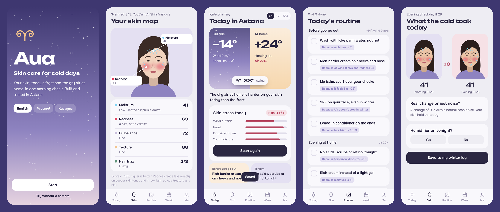
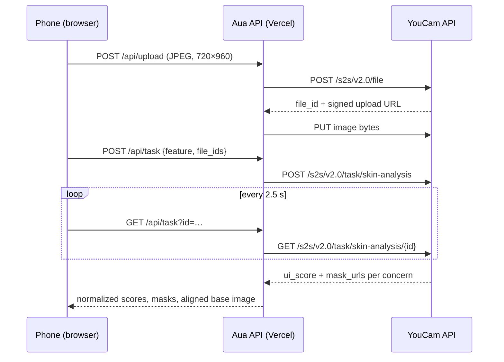

# Aua: skin care for cold days

**A morning skin check for Astana winters.** YouCam Skin AI reads your skin; Aua adds today's frost and the dry air in your heated home, and turns it all into a routine where every step says *why*.

**[▶ Try the live app](https://aua-five.vercel.app)** · Demo video: *coming soon* · Built for the [YouCam API Skin AI & eCommerce VTO Hackathon](https://youcam-api-skin-ai-ecommerce.devpost.com/) (Skin AI track)



## The problem

In January, Astana can be **−27 °C** outside. Central heating warms that same air to +24 °C, and its relative humidity drops to **about 2%**. Indoor comfort is usually quoted at 40–60%. Skin goes through that swing twice a day, all winter.

A dermatologist we interviewed:

> “Complaints rise noticeably exactly when the central heating is switched on.”
>
> “What hurts skin most is the combination: cold, wind, dry indoor air and the constant move from a warm room to the street and back.”

Skincare apps score your skin. None of them connect the score to the weather outside and the air at home, so people keep buying richer creams without knowing what actually changed.

## What it does

| Screen | What happens |
|---|---|
| **Scan** | Guided camera (framing oval + live light meter) sends one photo to **YouCam Skin Analysis**: moisture, redness, oiliness, texture, pores, radiance, with mask overlays on your own photo. Optional: 3 hair photos for **YouCam Hair Frizziness Detection**. |
| **Today** | Live weather (Open-Meteo) plus the humidity in your heated home (Magnus-formula estimate or your hygrometer) become a 1–5 skin-load score that shows which factor dominates today. |
| **Routine** | “Before you go out” and “evening at home” steps. Every step carries its reason: *because wind 9 m/s and redness 63*. Products matched to today's needs link to a Kaspi.kz search, Kazakhstan's main marketplace. |
| **Evening** | A second scan. Morning vs evening with a noise threshold, so random variation isn't sold as change. |
| **Week** | 7-day forecast → hardest day, a calm night for actives, a good day for a mask. |
| **Winter in numbers** | Your own moisture scores plotted against the outdoor temperature. |
| **See a dermatologist** | Signs a cream won't fix, from our dermatologist interview. Aua stops suggesting products. |

English, Russian and Kazakh (reviewed by a native speaker). A demo mode with three sample people works without a camera.

## How we use the YouCam API

The key never reaches the browser: the app talks to small Vercel functions in [`api/`](api/), which call YouCam.



| YouCam API | Endpoint | Input | Units | Used for |
|---|---|---|---|---|
| **AI Skin Analysis** (SD) | `/s2s/v2.0/task/skin-analysis` | 1 face photo, 6 concerns, mask overlays | 12 | Skin map, routine reasons, evening comparison, winter chart |
| **Hair Frizziness Detection** | `/s2s/v2.0/task/hair-frizziness-detection` | 3 photos: front, right, left | 2 | Anti-static and hair-heat steps |

YouCam error codes (too dark, face too small, out of frame, no face, pose) are mapped to plain hints in the camera. Masks are drawn over the resized image YouCam returns, so they line up exactly.

## From scores to advice

All rules live in one pure, tested file: [`js/rules.js`](js/rules.js).

- **Home humidity**: outdoor air at its temperature and humidity, heated to +24 °C (Magnus formula). −14 °C at 78% → ≈5.5% indoors; −24 °C at 80% → ≈2.4%.
- **Skin load (1–5)**: wind 30%, frost 20%, dry home air 30%, your moisture score 20%. The screen shows which part dominates.
- **Routine**: each step is triggered by a named number and shows it. Checked against our dermatologist interview: SPF stays on in winter, no acids or scrubs while the barrier is stressed, a light gel-cream for skin that is oily but dehydrated, gentler heat for hair.
- **Evening check**: a change smaller than the scan-to-scan noise is reported as noise.

## What is real and what is sample

Said plainly, so nobody has to guess:

- **Real**: YouCam scores and masks, live weather, the humidity physics, the rules.
- **Estimate**: home humidity, unless you enter a hygrometer reading.
- **Heuristic**: the skin-load score and its weights. It is not a medical measurement.
- **Sample**: the three demo people and their scores (drawn faces, labelled as samples), and the demo-shop prices.
- **Not stored**: photos. Only scores stay on the device (localStorage); “Delete all my data” wipes them.

Aua gives care tips. It does not diagnose.

## Run it

```bash
npm test                         # 18 tests (node:test), no network needed
npm run dev -- --mock            # http://localhost:3000 with fake YouCam + weather
cp .env.example .env             # then put your key in it
node --env-file=.env tools/dev-server.mjs   # real API (Node 20.6+)
```

No build step: static files at the root, serverless functions in `api/`.

### Deploy (Vercel, works from an iPad)

1. Import this repository in Vercel. Framework preset: **Other**, no build command.
2. Settings → Environment Variables: `YOUCAM_API_KEY` = your key from the YouCam API console. Optional: `AUA_DEBUG_RAW=1` returns the raw YouCam JSON.
3. Redeploy and open the site on your phone. Without a key the app opens in demo mode.

## Project layout

```
index.html, styles.css     the app (vanilla JS modules, no build)
js/app.js                  screens, camera, routing
js/rules.js                weather + scores → load, routine, week plan (pure, tested)
js/i18n.js                 English / Russian / Kazakh
js/face.js, js/data.js     illustrated faces, demo people, demo shop
api/                       Vercel functions: upload, task, weather, health
tools/dev-server.mjs       local server, --mock mode
test/                      node:test
```

## Team

Built in Astana by a data engineer and a medical student.

MIT License.
